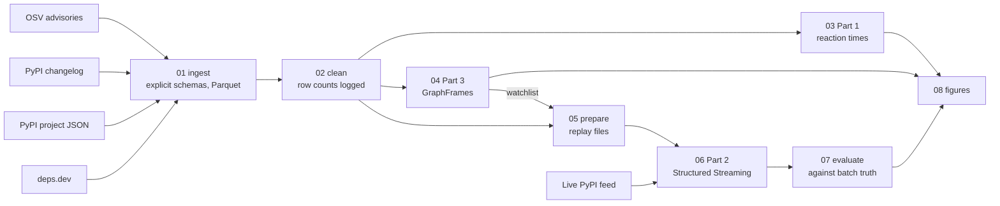

# PyPI Security Project

**Which vulnerable open-source Python packages put the most of the ecosystem at risk, and how fast does the ecosystem react?**

A big-data study of the Python Package Index with Apache Spark, in three parts: Volume (batch, Spark SQL), Velocity (Structured Streaming) and Variety (graph analysis with GraphFrames). It follows the structure of the project in the *Data Processing and Analytics* course of my master's, as an independent project with no teammates. It was not submitted for grading.

> **Status:** the code is complete and tested on a sample. The full data run is in progress; results and the report will be added here when it finishes.

## The questions

| Part | Spark tool | Sub-question |
|---|---|---|
| 1 Volume | Spark SQL, DataFrames | How long do malicious packages stay online? When does a fix ship relative to disclosure? How many flaws are still in the version `pip` installs today? |
| 2 Velocity | Structured Streaming | Can the live PyPI feed flag short-lived projects, new maintainers on critical packages and new advisories within a minute, and what does each watermark cost? |
| 3 Variety | GraphFrames | Which flawed packages have the widest reach through the dependency graph, how many dependents cannot escape a flaw, and how stable is the ranking? |

## The data

Everything comes from open sources with no account needed. [docs/DATA_SOURCES.md](docs/DATA_SOURCES.md) has the licences, terms and crawl rules.

| Dataset | What it gives | Size |
|---|---|---|
| [OSV](https://osv.dev) PyPI advisories | Vulnerabilities and malicious-package reports, affected versions, severity | 26,802 records, 85 MB |
| [PyPI changelog](https://docs.pypi.org/api/) | Every event on PyPI since 2002: uploads, removals, quarantines, maintainer changes | 42.5 million events, 3.48 GB |
| [PyPI project JSON](https://docs.pypi.org/api/json/) | Releases with upload dates, and the dependencies of the latest version | Filled in after the run |
| [deps.dev](https://deps.dev) API | Dependent counts, as an outside check on my graph | About 2,000 packages |

The sources are joined on the PEP 503 normalised project name.

## Pipeline



Part 3 runs before Part 2 because the stream's watchlist comes from the graph's numbers.

## How to reproduce

You need Docker, about 30 GB of free disk and at least 8 GB of memory for Docker. The image is the course's `jupyter/pyspark-notebook:spark-3.5.0` with GraphFrames and `packaging` added.

```bash
docker compose build
```

### A short trial first (about 25 minutes)

This uses a small seeded sample and writes to `data/sample`, so it can't touch the real results.

```bash
docker compose run --rm spark bash run_sample.sh
```

### The full run

The download is slow on purpose: PyPI asks API clients to spread their requests. It can stop and resume at any point, and nothing is fetched twice.

```bash
docker compose run --rm spark python src/00_download.py all
```

Then the analysis:

```bash
docker compose run --rm spark bash run_pipeline.sh
```

Results land in `results/`, figures in `report/figures/`, and intermediate tables in `data/`.

## Repository layout

```
src/00_download.py        all raw data, restartable (standard library only)
src/01_ingest.py          raw files to typed Parquet, explicit schemas
src/02_clean.py           cleaning, with a row count for every step
src/03_part1_volume.py    Part 1: reaction times
src/04_part3_graph.py     Part 3: GraphFrames, ranking, sensitivity, deps.dev check
src/05_part2_prepare.py   Part 2: replay files, batch truth, watchlist
src/06_part2_stream.py    Part 2: Structured Streaming (replay, watermarks, live)
src/07_part2_evaluate.py  Part 2: stream against batch truth and OSV
src/08_figures.py         the report's figures
tests/test_helpers.py     CVSS scoring and version-range logic
docs/DATA_SOURCES.md      sources, licences, crawl rules
run_sample.sh             short trial on a sample
run_pipeline.sh           the full analysis
```

## Attribution

Advisory data from the [GitHub Advisory Database](https://github.com/github/advisory-database), the [PyPA Advisory Database](https://github.com/pypa/advisory-database) and [OpenSSF Malicious Packages](https://github.com/ossf/malicious-packages), via [OSV.dev](https://osv.dev). Dependency counts from [deps.dev](https://deps.dev). None of them endorses this work.
